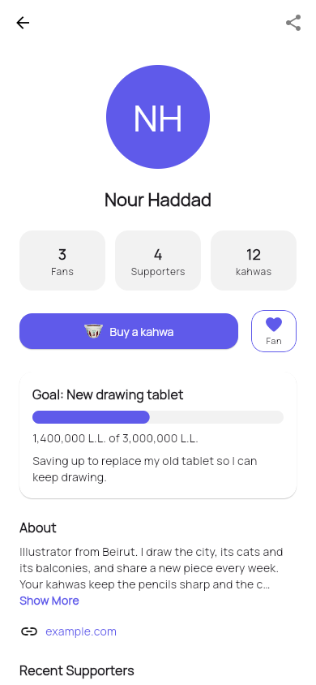
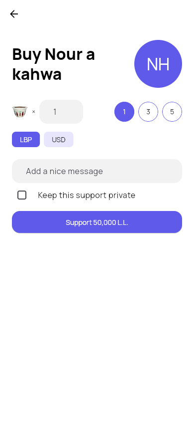
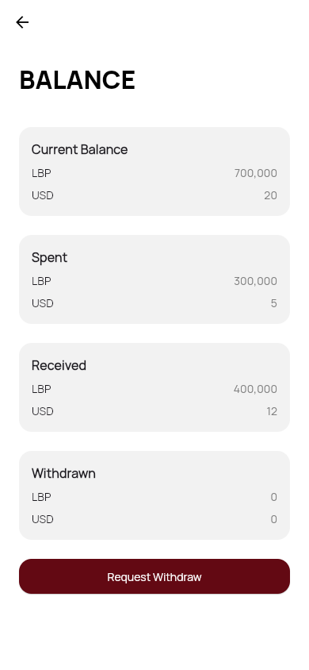
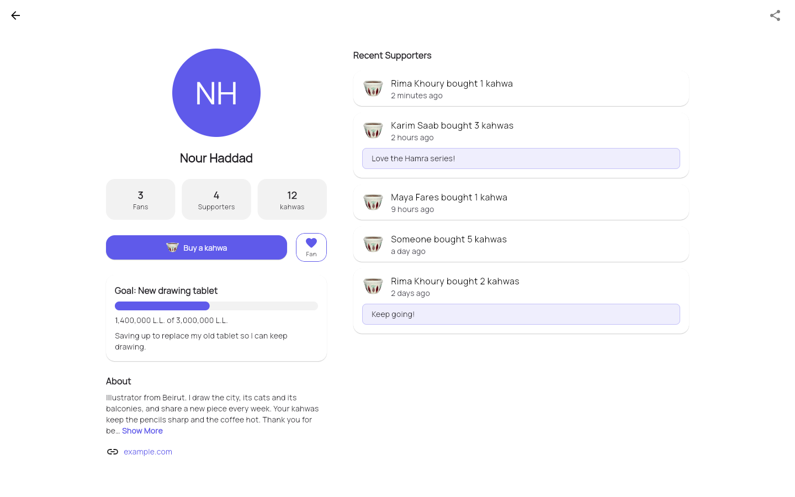

# kahwa

[](https://github.com/georges-ph/kahwa/actions/workflows/ci.yml)
[](https://github.com/georges-ph/kahwa/releases)
[](LICENSE)

Buy your favorite Lebanese creators a kahwa.

kahwa is a Lebanese take on Ko-fi and Buy Me a Coffee. Creators get a page of
their own, fans support them one kahwa at a time in LBP or USD, and creators
withdraw what they receive through Whish Money. It is built with Flutter and
Firebase, and runs on Android and the web.

**[Landing page](https://georges-ph.github.io/kahwa/)**

## Screenshots

| Creator page | Buy a kahwa | Balance |
| --- | --- | --- |
|  |  |  |



## Features

- **Creator pages** with a picture, an about text, a website and one of six
  page colors. Each page has its own address to share.
- **Kahwas** priced by the creator in LBP and USD, with an optional message.
  Supporters can keep their support private.
- **Fans**: follow creators and find them again on your home screen.
- **Goals** with a progress bar that fills as kahwas come in.
- **Balance** tracking, billing details and withdraw requests through Whish
  Money.
- **Every screen size**: phone, tablet and desktop layouts.

## Status

Version 2.0.0. The app is a working project rather than a live service. Money
moves between balances inside the app: topping up a balance and paying out a
withdraw request are handled manually outside of it.

## Setup

You need [Flutter](https://docs.flutter.dev/get-started/install) 3.41.5 and a
[Firebase](https://console.firebase.google.com) project with Authentication
(email and password), Cloud Firestore, Realtime Database and Storage enabled.

1. Clone the repository and install the dependencies:

   ```sh
   git clone https://github.com/georges-ph/kahwa.git
   cd kahwa
   flutter pub get
   ```

2. Add your Firebase configuration. These files are different for every
   developer and are not in the repository. Either run
   [`flutterfire configure`](https://firebase.google.com/docs/flutter/setup),
   or copy the templates and fill in the values from your Firebase project:

   ```sh
   cp lib/firebase_options.dart.example lib/firebase_options.dart
   cp android/app/google-services.json.example android/app/google-services.json
   ```

3. Run the app:

   ```sh
   flutter run -d chrome   # web
   flutter run             # Android device or emulator
   ```

### Local emulators

To work without touching a real Firebase project, start the
[Firebase emulators](https://firebase.google.com/docs/emulator-suite) and tell
the app to use them. The emulators need Java.

```sh
firebase emulators:start --config firebase.emulators.json --import local_data --export-on-exit
flutter run -d chrome --dart-define=USE_EMULATORS=true
```

On the web, reloading the page signs you out while using the emulators.

### Deploying the web app

The web app is hosted on its own Firebase Hosting site. Copy
`.firebaserc.example` to `.firebaserc`, fill in your project and site, then:

```sh
flutter build web --release --dart-define=APP_URL=https://your-site.web.app
firebase deploy --only hosting
```

`APP_URL` is the address used in the links creators share. The web app works
it out by itself, so it only matters for Android builds.

The landing page in [`landing/`](landing) is deployed to GitHub Pages by the
`Landing page` workflow whenever it changes.

## Project structure

```
lib/
  main.dart        Firebase setup and app start
  app.dart         MaterialApp and router
  core/            theme, routes, breakpoints, small helpers
  models/          plain data classes that map to Firestore documents
  data/            repositories, the only code that talks to Firebase
  screens/         one file per screen
  widgets/         pieces shared between screens
test/              unit and widget tests
landing/           landing page (GitHub Pages)
```

## Contributing

Contributions are welcome. See [CONTRIBUTING.md](CONTRIBUTING.md).

## License

[MIT](LICENSE)
