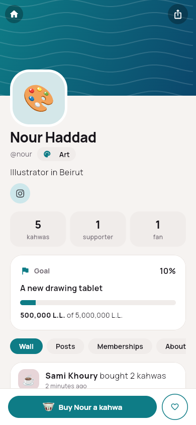
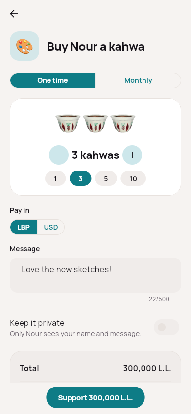
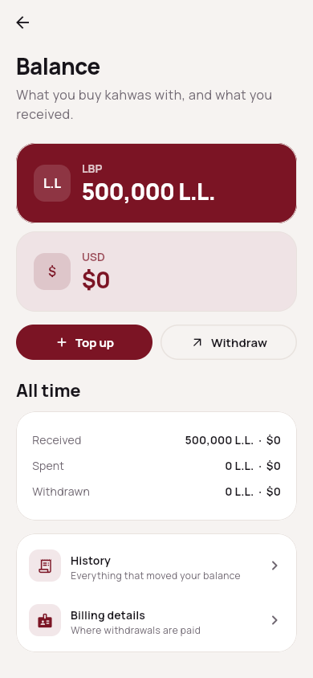
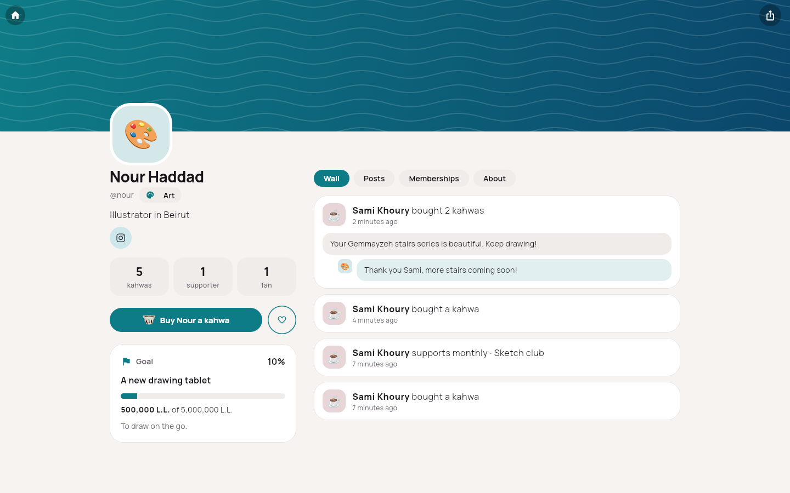

# kahwa

[](https://github.com/georges-ph/kahwa/actions/workflows/ci.yml)
[](https://github.com/georges-ph/kahwa/releases)
[](LICENSE)

Buy your favorite Lebanese creators a kahwa.

kahwa is a Lebanese take on Ko-fi and Buy Me a Coffee. Creators get a page of
their own, fans support them one kahwa at a time or with a monthly
membership, in LBP or USD, and creators withdraw what they receive through
Whish Money. It is built with Flutter and Firebase, runs on Android and the
web, and speaks English, French and Arabic.

**[Landing page](https://georges-ph.github.io/kahwa/)**

## Screenshots

| Creator page | Buy a kahwa | Balance |
| --- | --- | --- |
|  |  |  |



## Features

- **Creator pages** with a banner in one of twelve colors and six patterns,
  an emoji avatar, a tagline, an about text, a category and up to eight
  links. Each page has its own address and QR code to share, with a username
  the creator picks.
- **Kahwas** priced by the creator in LBP and USD, with an optional message
  the creator can answer. Supporters can keep their support private.
- **Memberships**: up to three monthly tiers per page. Members are charged
  from their balance every 30 days, when they open the app (kahwa has no
  server), and see members-only posts.
- **Posts** on the page, public or for members only, and a feed of the
  creators you are a fan of on the home screen.
- **Activity**: an inbox in the app for kahwas, new members, fans, replies,
  top ups and withdrawals. No push notifications, which would need a server.
- **Explore**: every creator, by category, with search and sorting.
- **Goals** in LBP or USD, with a progress bar that fills as kahwas come in.
- **Stats** for creators: kahwas over time, top supporters and members.
- **Balance**: top ups and withdrawals through Whish Money. A user sends the
  money, confirms it in the app, and an admin approves the request. A
  history shows every kahwa, top up and withdrawal.
- **Paid straight to WHISH**: a creator can also take kahwas on their own
  WHISH account, set up from a screenshot of their Whish Me QR code. They
  confirm each payment before it counts.
- **Admin screen** for the people running it: the total held for users, the
  top up and withdraw requests waiting for a decision, every user's money,
  balance corrections with a written reason, and a log of who did what.
- **Account security** without a server: money only moves once the email is
  verified (Google accounts are), a password change, and a list of signed in
  devices that can each be signed out.
- **Sign in** with an email and a password, or with Google, then a short
  first setup.
- **English, French and Arabic**, light and dark, on phone, tablet and
  desktop.

## Status

Version 3.0.0, a rewrite of the whole app: the web app is live, and the
Android app is on the [releases page](https://github.com/georges-ph/kahwa/releases/latest).
It is a working project rather than a live service. Money moves between balances inside the app, and the
security rules only let a balance change in four ways: by the total of a
kahwa or a membership month paid in the same transaction, by an admin
approving a top up or a withdraw request of that user, or by an admin
correction that keeps its reason. The transfers
themselves happen outside the app, through Whish Money, and an admin checks
them by hand.

kahwa 3 keeps its data under `kahwa/AppData` in Firestore. kahwa 2 used
`kahwa/AppCollections`, and its data is not carried over.

## Setup

You need [Flutter](https://docs.flutter.dev/get-started/install) 3.41.5 and a
[Firebase](https://console.firebase.google.com) project with Authentication
(email and password, and Google) and Cloud Firestore enabled. For Google sign
in, add the address of your site to the authorized domains of
Authentication, and the SHA-1 fingerprint of your signing key to your
Android app in the project settings.

1. Clone the repository and install the dependencies:

   ```sh
   git clone https://github.com/georges-ph/kahwa.git
   cd kahwa
   flutter pub get
   ```

2. Add your Firebase configuration. These files are different for every
   developer and are not in the repository. Either run
   [`flutterfire configure`](https://firebase.google.com/docs/flutter/setup),
   or copy the templates and fill in the values from your Firebase project:

   ```sh
   cp lib/firebase_options.dart.example lib/firebase_options_dev.dart
   cp lib/firebase_options.dart.example lib/firebase_options_prod.dart
   cp android/app/google-services.json.example android/app/google-services.json
   ```

   Release builds use the `prod` file and everything else, such as
   `flutter run`, the `dev` one, so testing does not touch real data. With a
   single Firebase project, put the same values in both. With two, also save
   their Android files as `android/app/google-services-dev.json` and
   `google-services-prod.json`: the build copies the right one over
   `google-services.json`.

3. Add the security rules. The Firestore rules the app expects are in
   [`docs/firestore.rules`](docs/firestore.rules).

4. In the Firebase console, under `kahwa/AppData` in Firestore:

   - create `Config/top_up` with the text inside your "Whish Me" QR codes
     (`https://whish.money/pay/...` links): `whish_qr_lbp` for the code of
     your LBP balance and `whish_qr_usd` for the one of your USD balance.
     WHISH gives a different code per currency, and top ups are only offered
     in the currencies you fill in. Users pay through it, on a phone with a
     button that opens the WHISH app and elsewhere by scanning the code.
     They see your name in WHISH, never a phone number. The app itself shows
     neither;
   - create `Admins/<user id>` (any content) for each account that should see
     the admin screen. The user id is in Authentication. Only the console can
     create these documents.

5. Run the app:

   ```sh
   flutter run -d chrome   # web
   flutter run             # Android device or emulator
   ```

### Local emulators

To work without touching a real Firebase project, start the
[Firebase emulators](https://firebase.google.com/docs/emulator-suite) and tell
the app to use them. The emulators need Java and enforce the rules in
`docs/firestore.rules`.

```sh
firebase emulators:start --only auth,firestore --config firebase.emulators.json --import local_data --export-on-exit
flutter run -d chrome --dart-define=USE_EMULATORS=true
```

On the web, reloading the page signs you out while using the emulators. A
build made for the emulators never holds the production configuration. If
the emulators answer elsewhere, set `EMULATOR_HOST` (`10.0.2.2` from an Android
emulator), `AUTH_EMULATOR_PORT` and `FIRESTORE_EMULATOR_PORT` with
`--dart-define`.

To try the whole app with demo data in one go, on Windows:

```powershell
powershell -ExecutionPolicy Bypass -File tool\try_local.ps1
```

It builds the web app, starts the emulators in a new window, fills them with
[`tool/seed_emulators.mjs`](tool/seed_emulators.mjs) and opens
http://localhost:5000. Sign in as `nour@example.com` / `kahwa-demo-1` (a
creator with a page, posts and memberships, and an admin) or
`sami@example.com` / `kahwa-demo-2` (a supporter with a balance), or with
any other email to start a new account. Close the emulators window to stop;
the data goes with it.

### Deploying the web app

The web app is hosted on its own Firebase Hosting site. Copy
`.firebaserc.example` to `.firebaserc`, fill in your project and site, then:

```sh
flutter build web --release --dart-define=APP_URL=https://your-site.web.app
firebase deploy --only hosting
```

`APP_URL` is the address used in the links creators share. The web app works
it out by itself, so it only matters for Android builds.

A release build talks to the production project. To put a build that stays
on the development project on a test site, add
`--dart-define=FIREBASE_ENV=dev`. The same works for Android:
`flutter build apk --release --dart-define=FIREBASE_ENV=dev` builds a full
speed "kahwa dev", signed with the debug key.

### Android release builds

Copy `android/key.properties.example` to `android/key.properties` and fill
in your release keystore. Without it, release builds are signed with the
debug key.

The Android app and the website share saved passwords through
[`web/.well-known/assetlinks.json`](web/.well-known/assetlinks.json) and
`asset_statements` in `android/app/src/main/res/values/strings.xml`. If you
build your own, put your package name, the SHA-256 fingerprint of your key
and the address of your site in those two files.

The landing page in [`landing/`](landing) is deployed to GitHub Pages by the
`Landing page` workflow whenever it changes.

## Project structure

```
lib/
  main.dart        Firebase setup and app start
  app.dart         MaterialApp, theme and language
  router.dart      every address of the app
  core/            config, money, usernames, text helpers
  models/          plain data classes that map to Firestore documents
  data/            repositories, the only code that talks to Firebase
  state/           Riverpod providers and saved settings
  features/        screens, one folder per part of the app
  ui/              pieces shared between screens
  theme/           colors and the Material theme
  l10n/            English, French and Arabic strings
test/              unit and widget tests
tool/              local demo with the emulators
landing/           landing page (GitHub Pages)
```

## Contributing

Contributions are welcome. See [CONTRIBUTING.md](CONTRIBUTING.md).

## License

[PolyForm Noncommercial 1.0.0](LICENSE): free to use, change and share for
any non-commercial purpose, keeping the copyright notice. Selling kahwa or
using it commercially, including a fork or copy, is not allowed. Releases up
to 2.0.0 were published under the MIT license.
